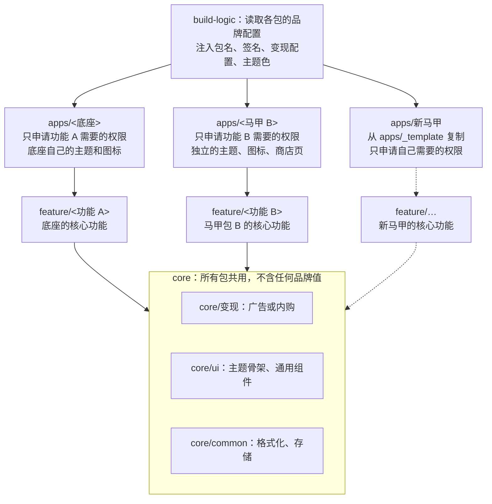

# 马甲包通用手册：基于多品牌构建体系

2026-11-11 · 从在线文档导出；以后两边分别维护，改动时注意同步。

底座专属内容见附录：[附录 A：Undelix 底座](appendix-a-undelix.md)

## 结论

可以批量复用的是“底座”，功能不能复用。本手册不绑定具体应用：换一个底座时，先按「底座准入与适配」做一次适配，之后每个马甲包按「单个马甲包的标准流程」出包。只换名称、颜色、图标的换皮包在 Play 上属于重复内容，不做。

- **目标**：基于任意一个已上架的底座应用，快速做出多个马甲包。每个包的核心功能都不同，并且能单独过审。
- **共用的部分**：变现（广告或内购 / 订阅）、隐私授权、远程开关、设置页通用项、图标生成脚本、隐私政策模板、上架材料模板、构建脚本。
- **每个包自己做的部分**：核心功能、主流程、页面、权限，以及商店素材。
- **文档怎么用**：本页是通用手册，换底座时不用改。每个底座单独写一份附录，记录它的技术栈、构建落地方式、已经出的包和后续路线。目前已有的附录：[附录 A：Undelix 底座](appendix-a-undelix.md)。

## 过审红线

最容易被拒的是前两条：重复内容和敏感权限声明。每个马甲包上架前，要逐条对照下表。

| 政策 | 什么情况会触发 | 我们的做法 |
| --- | --- | --- |
| 垃圾应用与重复内容 | 同一开发者（或关联账号）发布多个功能、内容、体验高度相似的应用 | 每个包的核心功能必须不同（见「差异化分级」） |
| 敏感权限声明 | 敏感权限（见下节对照表），申请了但说不清为什么是核心功能 | 每个包只申请自己核心功能需要的权限，声明文案和演示视频单独准备 |
| 最低功能要求 | 功能太单薄，或者只是系统自带功能的入口 | 在系统能力之上至少有一项自己的价值（例如到期提醒） |
| 元数据 | 描述夸大、堆积关键词、模仿知名应用 | 描述只写本应用实际能做到的事，截图必须是真实截图 |
| 广告 | 意外点击、影响正常操作的插屏、拦截返回键 | 所有包共用同一套广告频率规则，插屏只放在操作完成之后 |
| 账号关联 | 用多个账号规避处罚；关联账号中有一个被封，其他账号会被连带处罚 | 见「账号与基础设施隔离」 |
| 新账号测试要求 | 2023 年 11 月 13 日之后注册的个人开发者账号 | 先做封闭测试：12 名测试者连续 14 天，之后才能申请正式版 |

审核时看到的是用户能接触到的体验和商店页面。代码上共用广告和工具类是行业常见做法，但前提是界面和功能看起来确实是另一个应用。这是根据政策做的判断，官方并没有公开按代码相似度判定的标准。

### 不建议投入的两个方向

下面两种做法看起来能绕开审核，但后果比被拒严重得多，不研究、不投入：

| 方向 | 结论 |
| --- | --- |
| 用代码混淆或资源打乱来规避相似度检测 | 属于规避平台检测，被发现会直接封账号 |
| 审核期和上线后展示不同内容（A 面 / B 面） | Play 把这类行为算作欺骗行为 |

两条边界：

- release 包正常开启代码混淆和资源压缩（例如 Android 的 R8）不算。这里说的是专门为了让审核认不出相似而做的处理。
- 用远程开关调整广告频率、关闭某个广告位不算。但不能用远程开关在上线后切换成审核时没有的功能或内容。

## 敏感权限类别对照

换底座时变化最大的是敏感权限。选题阶段就要确定新包会碰到下表哪一类；能用替代方案的，就不申请这个权限。下表是按我对 Play 政策的理解整理的，每次上架前都要到 Play 政策中心核对最新要求。

| 权限类别 | 典型权限 | Play 的要求 | 替代方案 |
| --- | --- | --- | --- |
| 所有文件访问 | `MANAGE_EXTERNAL_STORAGE` | 提交声明；只允许文件管理、备份恢复、杀毒等必须广泛访问文件的核心功能 | 存储访问框架（SAF）、MediaStore |
| 照片和视频 | `READ_MEDIA_IMAGES`、`READ_MEDIA_VIDEO` | 提交声明；只允许需要广泛访问媒体的核心功能 | 系统照片选择器 |
| 短信和通话记录 | `READ_SMS`、`READ_CALL_LOG` 等 | 提交声明；基本只允许默认短信 / 电话应用及少数例外 | SMS Retriever API、让用户手动输入 |
| 后台位置 | `ACCESS_BACKGROUND_LOCATION` | 提交声明和演示视频，并在应用内显著说明 | 只在前台使用位置 |
| 无障碍服务 | `AccessibilityService` | 提交声明；非辅助工具类应用需要显著说明并取得用户同意 | 一般没有替代方案，尽量不选依赖它的题 |
| 已安装应用列表 | `QUERY_ALL_PACKAGES` | 提交声明；只允许必须枚举所有应用的核心功能 | 清单里用 queries 声明具体的包名或 intent |
| 前台服务 | `FOREGROUND_SERVICE_*`（Android 14 起要求声明类型） | 在 Play Console 声明服务类型和用途 | WorkManager |
| 精确闹钟 | `USE_EXACT_ALARM` | 只允许闹钟、日历类应用 | `SCHEDULE_EXACT_ALARM`（由用户授权）或 WorkManager |
| 全屏通知 | `USE_FULL_SCREEN_INTENT` | 只允许来电和闹钟 | 普通通知 |
| 安装其他应用 | `REQUEST_INSTALL_PACKAGES` | 只允许属于核心功能的场景 | 跳转到应用商店 |
| VPN | `VpnService` | 提交声明；VPN 必须是核心功能 | 无 |

同一个底座下的不同马甲包，最好落在不同的权限类别里。比如附录 A 里，Undelix 用所有文件访问，Trash Keeper 用照片和视频。权限不同本身就说明两个包的功能不一样。

## 差异化分级

马甲包至少要做到 L2：和底座属于同一领域，但核心功能不同。L2 既能复用领域知识和基础设施，又能讲清楚“这是另一个应用”。

| 级别 | 变化内容 | 过审风险 | 底座复用 | 结论 |
| --- | --- | --- | --- | --- |
| L0 换皮 | 名称、图标、主题色 | 高，属于重复内容 | 几乎全部 | 不做 |
| L1 换交互 | 同一功能，换页面布局和流程 | 高，功能和结果仍然一样 | 大部分 | 不做 |
| L2 同领域、不同核心功能 | 核心用途、数据来源、主流程、权限都不同 | 低 | 基础设施 + 领域工具类 | 主力方向（示例见附录 A） |
| L3 跨领域 | 完全不同的工具 | 最低 | 只有基础设施 | 可以做，但每个包成本更高 |

开工前对照下面的清单。前六项任意一项与已上架的包相同，就回到选题阶段：

- [ ] 核心用途：用一句话说清楚它解决的问题，并且和其他包不同
- [ ] 主流程：从打开应用到拿到结果的步骤不同
- [ ] 数据来源和权限：申请的权限只服务于本包的核心功能
- [ ] 页面结构：首页的信息组织方式不同，不只是换颜色
- [ ] 视觉：主题（浅色 / 深色）、主色、图标图形、字体风格
- [ ] 商店页：名称、图标、截图、短描述、长描述全部重写
- [ ] 技术身份：包名、上传密钥、广告 / 结算应用、远程配置项目、隐私政策网址，每个包独立

可以共用的部分：变现（广告或内购）和频率规则、隐私授权、远程开关、设置页里的评分 / 分享 / 反馈 / 隐私项、格式化工具、图片加载。

## 底座准入与适配

每个新底座先做准入检查，再做一次性适配。适配完成的标志是：用模板新建一个空的品牌壳，能打出可以上传的 release 包。如果想先验证选题，也可以像附录 A 的 Trash Keeper 那样，先复制代码出第一个包，过审后再做适配。

### 准入检查表

| 检查项 | 要回答的问题 | 不满足时 |
| --- | --- | --- |
| 上架状态 | 底座是否已在 Play 上发布正式版，并且没有政策警告 | 先让底座稳定下来；底座或账号有警告时，不要在它上面出包 |
| 领域纵深 | 同一领域内能否想出至少 2 个核心功能不同的方向 | 只能做 L3（跨领域），复用率低，先评估值不值得 |
| 基础设施是否可拆 | 变现、隐私授权、远程开关是否和业务代码解耦 | 先在底座内重构，再拆出 core |
| 技术栈 | 构建工具是否支持多个入口工程共用一套库 | 见「多品牌构建体系」的技术栈对照 |
| 变现方式 | 靠广告，还是靠内购 / 订阅 | 内购类每个包单独配置商品和结算，品牌配置清单要加上对应项 |
| 敏感权限 | 底座用了哪一类敏感权限 | 新马甲包尽量避开同一类 |
| 上架商店 | 只上 Google Play，还是也上 App Store | App Store 的 4.3 Spam 规则更严，需要单独评估 |

### 一次性适配步骤

1. **盘点底座**：填写准入检查表，结果写进新附录的「底座概况」。
2. **拆出 core**：把基础设施拆成公共模块。底座的行为保持不变，包名、签名、广告位、结算商品都不改。
3. **建构建约定**：品牌配置文件加上约定插件（或所用技术栈里的等价做法）。缺少必填字段时直接报错。
4. **底座自身拆分**：底座拆成一个品牌壳和一个功能模块。
5. **做模板和脚手架**：提供 `apps/_template`，再写一个新建品牌的脚本。
6. **写附录**：按附录 A 的四节结构写，分别是底座概况、构建体系落地、已出马甲包、落地路线与待定事项。

## 多品牌构建体系

每个马甲包用一个独立的入口工程（Android 上是 app 模块）作为“品牌壳”，下面共用公共模块，按需引入功能模块。品牌差异由构建约定从品牌配置文件（Android 上是 `brand.properties`）注入。



从上到下依次是构建约定、品牌壳、功能模块、公共模块。箭头表示依赖，品牌壳也直接依赖 core（图中省略），虚线为下一个马甲包。新增一个马甲包，只需要加一个品牌壳和它自己的功能模块，core 不用改。

### 为什么不能只靠“一个工程、多套配置”

大多数技术栈都支持在一个工程里配多套配置，比如 Android 的 productFlavors、Flutter 的 flavor、Xcode 的多个 scheme。这种做法适合换皮，但不适合功能不同的马甲包：

- **权限会合并**：共用部分声明的权限会出现在每个包里。多出来的敏感权限要多交一份声明，还容易被拒。
- **核心配置不同**：最低系统版本、依赖、后台任务这些配置，各包往往都不一样。
- **代码会串包**：共用目录里的功能代码会被打进所有包。

品牌配置文件、校验规则、签名退回逻辑、按品牌生成图标的脚本都可以继续用。区别只在于：它们不再用来生成多套配置，而是用来配置每个包自己的入口工程。

### 技术栈对照

原则都一样：每个包有自己的入口工程，共用同一套库。Android 原生这一行已经在附录 A 验证过；其余几行是通用做法的概括，还没有在本项目里验证。

| 技术栈 | 品牌壳 | 共用代码 | 品牌配置注入 |
| --- | --- | --- | --- |
| Android 原生（Gradle） | 每个包一个 application 模块 | library 模块 | build-logic 约定插件读取 `brand.properties` |
| Flutter | 每个包一个应用工程 | Dart package（monorepo） | 脚本读取品牌配置，生成原生工程的包名、图标、签名 |
| iOS 原生 | 每个包一个 target 或独立工程 | Swift Package | xcconfig |
| Unity | 每个包一个工程 | UPM 包 | 编辑器构建脚本读取品牌配置 |

### 目录结构

```
build-logic/          构建约定：读取品牌配置，设置包名、版本、签名、变现配置
core/monetization/    广告或内购、频率规则、隐私授权、远程开关
core/ui/              主题骨架（颜色由品牌传入）、通用组件、设置页通用项
core/common/          格式化、存储、权限工具
feature/<功能 A>/     底座的核心功能
feature/<功能 B>/     马甲包 B 的核心功能
apps/<底座>/          品牌壳：清单、权限、页面编排、品牌配置、资源
apps/<马甲 B>/
apps/_template/       新包从这里复制
store/<品牌>/         图标源文件、商店素材、隐私政策
```

### 各层规则

| 层 | 谁可以依赖它 | 规则 |
| --- | --- | --- |
| core | feature、apps | 不含任何品牌名称、颜色、文案；不申请危险权限 |
| feature | apps | 只申请本功能需要的权限；feature 之间不互相依赖 |
| apps | 无 | 写清单、页面和文案；只引入自己需要的 feature |
| build-logic | 所有模块 | 缺少必填字段时直接报错；包名是 com.example 前缀、没有上传密钥时，release 不能上传 |

## 单个马甲包的标准流程

底座完成适配后，每个马甲包一共 9 步，其中有两道闸门：第 2 步验证不通过就放弃选题，第 3 步过不了差异化清单就回到选题阶段。封闭测试至少 14 天，可以和第 8 步的合规材料同时做。

1. **选题**：在底座的领域里找一个相邻但不同的核心需求，并在 Play 上查竞品和重名。
    - 产出：一张定位对比表，列出核心用途、数据来源、主流程、独有功能、权限、视觉，和已上架的包逐项对比。
2. **可行性验证**：先用模拟器和真机验证核心系统接口是否可用，再写界面。
    - 产出：验证结论表。例如附录 A 里的 Trash Keeper 验证了只有媒体权限时，能否读取和还原其他应用放进回收站的文件。
3. **差异化设计**：对照「差异化分级」的清单，确定页面、主流程、权限和视觉。
    - 产出：页面清单、权限清单、变现位清单。
4. **建品牌壳**：复制 `apps/_template`，填写品牌配置文件，引入需要的 core 和 feature 模块。
5. **实现核心功能**：新功能写在 feature 模块里，纯计算规则要有单测，最后在 release 包上走一遍完整流程。
6. **品牌资源**：用脚本生成图标（各平台所需的应用图标、通知图标、商店图标），确定主题色，并准备真实截图。
7. **基础设施**：
    - 变现：新建广告应用和广告位（例如 AdMob）并发布 GDPR 消息，内购 / 订阅类应用配置本包的商品；
    - 新建远程配置 / 统计应用（例如 Firebase）；
    - 生成上传密钥，备份到团队密码库；
    - 发布隐私政策页面和 app-ads.txt；
    - 准备反馈邮箱。
8. **合规材料**：权限声明（写清核心用途，并附演示视频）、数据安全表单、内容分级、商店标题和描述。
9. **封闭测试和正式发布**：新个人账号需要 12 名测试者连续测试 14 天；之后先小比例分阶段发布，确认崩溃率和变现数据没有异常。

## 品牌配置清单

每个马甲包的品牌差异都放在自己的 `apps/<品牌>/` 目录和仓库外的账号里，公共模块里不出现任何品牌值。各底座的具体字段名写在附录里（附录 A 用的是 `brand.properties`）。

| 配置项 | 入库 | 说明 |
| --- | --- | --- |
| 包名、版本 | 是 | 包名上架后就不能再改 |
| 应用名称 | 是 | 上架前先在 Play 查重，并做商标检索 |
| 主题色、图标配色 | 是 | 构建时校验格式；图标图形每个包单独设计 |
| 隐私政策、反馈邮箱 | 是 | 必须是真实可用的地址，不能用 example.com |
| 变现配置 | 是 | 广告应用 ID 和广告位，或内购商品 ID；没填时 release 包不展示广告，debug 包只用测试广告位 |
| 上传密钥 | 否 | 每个包一把，备份到团队密码库 |
| 远程配置和统计 | 由团队约定 | 例如 Firebase 的 google-services.json；缺少时只提示警告，并使用应用内的默认值 |
| 远程开关模板 | 是 | 各包的变现位名称不同，模板按包分开维护 |
| 图标和商店素材 | 是 | 放在 `store/<品牌>/`：SVG 源文件、512 图标、截图、隐私政策页面 |
| 仓库外的账号 | — | 商店页、广告 / 结算应用、远程配置项目每个包单独创建；同一开发者账号下，开发者网站和 app-ads.txt 可以共用 |

## 账号与基础设施隔离

建议先把差异化达标的马甲包都放在同一个开发者账号下。只要功能确实不同，一个账号下有多个应用是正常情况。为了隔离风险而专门注册多个账号，反而容易被认定为关联账号。

| 方案 | 好处 | 风险 |
| --- | --- | --- |
| 同一开发者账号下放多个差异化应用 | 合规；封闭测试、开发者信息、网站都可以共用 | 一个应用严重违规可能影响整个账号，所以每个包都要过「过审红线」 |
| 多个账号分散放置 | 单个账号出事时影响范围小 | 需要独立的主体、支付方式、设备和网络；一旦被关联就会连带处罚，用它来规避处罚本身就违反政策 |

无论选哪种账号方案，应用级别的资源都要分开：

- **上传密钥**：每个包一把，避免一把密钥泄露影响所有包。
- **变现**：在同一个广告账号（例如 AdMob）下，为每个包新建应用和广告位，收入和无效流量按应用分开统计；内购类应用每个包单独配置商品。
- **远程配置**：每个包一个应用（例如 Firebase），变现开关可以按包单独关闭。
- **隐私政策**：每个包一个页面，内容写本包实际读取的数据；可以放在同一个域名的不同路径下。
