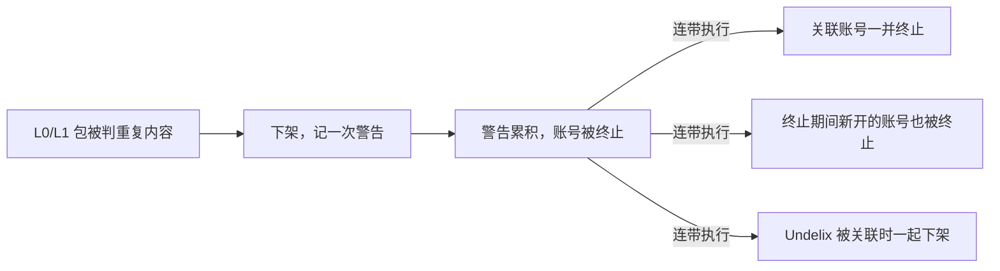

# 马甲包方案 v2：L0/L1 差异化 + 多账号提审

## 结论

L0/L1 加多账号提审，不建议作为主力方向。L0/L1 的包按 Play 政策就是「重复内容」；把它们分散到多个账号里，不会改变包的性质，只会把风险从“单个包被拒”放大成“多个账号一起被终止”。

- **为什么**：Play 的垃圾应用政策明确把“多个功能、内容、体验高度相似的应用”列为违规。L0 三项全中，L1 只改了体验，功能和内容仍然相同。
- **多账号的问题**：Play 终止一个账号时，会连带终止关联账号；终止期间新开的账号也会被终止。AdMob 只允许一人一个账号，重复账号会被关停。
- **可以怎么做**：要“多入口”，先用同一个应用的自定义商店页面；要出新包，就在 L1 的基础上加一项独有的核心功能，升到 L2；多账号只在有真实、独立的主体时才开，每个账号里的包各自达到 L2。
- **本文不包含**：如何避免账号被识别为关联账号（设备、网络、身份隔离等）。那属于规避平台处罚，被发现后的后果比被拒严重得多，所以不展开。

**眼下的第一步**：Undelix 还没上架，主包的变现链路没跑通。在这之前出任何马甲包都拿不到广告收入，见「Undelix 主包现状」。

## 按你的情况调整：个人账号 + 以广告收入为目标

你确认了两点：多个账号是个人账号，各自独立；做 L0/L1 主要是为了广告收入。按这两点重新算，结论不变，而且更明确：L0/L1 多账号换来的广告收入，大概率低于把同样的精力放在主包上。

### 个人账号意味着什么

- **每个账号都要从头跑一遍**：2023 年 11 月 13 日之后注册的个人账号，都要先做 12 名测试者 × 14 天的封闭测试，才能申请正式版。N 个账号就是 N 组测试者。
- **账号和收入归属于本人**：每个个人账号对应一个已验证的真实身份，应用的法律责任、广告收入和税务都在这个人名下。
- **“独立”要看实际谁在运营**：如果这些账号都由同一个团队控制、发布同一套代码的变体，在 Play 看来就是关联账号，而不是多个独立开发者。

### 以广告收入为目标时，L0/L1 并不划算

广告收入取决于三个量，多出几个同质包只能影响第一个：

```latex
\text{广告收入} = \text{DAU} \times \text{人均展示数} \times \frac{\text{eCPM}}{1000}
```

- **同质包互相抢流量**：功能相同的包会在同一组关键词下互相竞争，总 DAU 未必增加，只是被分散到多个包里。
- **每个新应用都要重新曝光、重新过审**：就像 Undelix 现在这样，AdMob 应用审核通过前广告基本无填充。每个马甲包都要经历一遍这个空窗期。
- **收入分散在不同人名下**：个人账号各自开 AdMob，收入和结算分散在各个人名下；共用一个 AdMob，又会把账号关联在一起。两条路都不好走。
- **一旦出事，已产生的收入也可能保不住**：账号终止后应用下架，收入归零；AdMob 因违规关停时，还可能被禁止使用其他 Google 变现产品。

### 更直接的收入杠杆

| 杠杆 | 对应公式里的 | 做法 |
| --- | --- | --- |
| 让广告先能展示 | 填充率 | 跟进 Undelix 的 AdMob 应用审核，关联 Play 商店页，发布 app-ads.txt |
| 接入聚合（mediation） | 填充率、eCPM | 在 AdMob 里加入其他广告网络一起竞价，单一网络无填充时仍有广告可展示 |
| 优化广告位和频率 | 人均展示数 | 用已有的远程开关按广告位调频率，结合留存看上限，不违反广告政策 |
| 提高留存和使用频次 | DAU | 增加用户会反复打开的功能，例如定期扫描提醒 |
| 多入口获客 | DAU | 自定义商店页面按国家、人群投放，效果接近 L0/L1 的多入口，但不占新账号 |

这五项都作用在同一个已上架的主包上，每一项的效果都可以直接用广告数据验证。

## 和上一版的区别

上一版《马甲包通用手册》的前提是“每个包至少 L2、放在同一个账号”。这次两个前提都变了，风险是叠加的。

| 项 | 上一版 | 这一版 | 影响 |
| --- | --- | --- | --- |
| 差异化 | L2 起步：核心功能、主流程、权限都不同 | L0 换皮 / L1 换交互 | 每个包都落在「重复内容」里 |
| 账号 | 同一个开发者账号 | 多个账号分别提审 | 一个账号出事，关联账号一起被终止 |
| 广告 | 同一个 AdMob 账号，每个包单独建应用 | 多个 Play 账号，变现账号怎么配还没定 | AdMob 一人一号，反而把各账号连在一起 |
| 单包成本 | 高：每个包要做新功能 | 低：改资源和页面 | 省下的是开发成本，换来的是账号风险 |

上一版里「不建议投入的两个方向」（用混淆规避相似度检测、A 面 / B 面）在这一版仍然成立。

## L0/L1 在审核侧的效果

L0/L1 能改变的只有“看起来”，改变不了“是什么”。Play 判断重复内容看的是功能、内容、用户体验三项，下表逐项对照。

| 审核会看的 | L0 换皮 | L1 换交互 |
| --- | --- | --- |
| 核心功能 | 相同 | 相同 |
| 内容 / 结果 | 相同 | 相同 |
| 用户体验 | 相同 | 不同 |
| 敏感权限声明 | 同一类权限、同一个核心用途 | 同一类权限、同一个核心用途 |
| 商店页 | 可以重写 | 可以重写 |

- **政策原文的口径**：Play 不允许只提供与商店里已有应用相同体验的应用，并把“创建多个功能、内容和用户体验高度相似的应用”列为常见违规（[Spam 政策](https://support.google.com/googleplay/android-developer/answer/9899034?hl=en)）。官方给的替代做法是把内容聚合到一个应用里。
- **敏感权限会放大问题**：Undelix 用的是所有文件访问。多个 L0/L1 包会提交几乎一样的权限声明和演示视频，这部分材料本身就是相似度证据。
- **商店页重写只是必要条件**：白牌应用指南要求每个应用有独立的描述、图标和截图（[白牌开发者最佳实践](https://support.google.com/googleplay/android-developer/answer/15884185?hl=en)），但商店页不同并不能抵消功能相同。
- **过一次审不等于安全**：重复内容可能在上架后才被识别和下架。每次下架都计为一次警告（strike），累计后会导致账号终止。

## 多账号提审的风险

多账号能分散的只是“单个包被拒”，分散不了“账号被终止”。Play 的终止按关联账号连带执行，而且关联信号不公开。

| 规则 | 内容 | 来源 |
| --- | --- | --- |
| 关联账号连带终止 | 多次或严重违规会终止当前账号及其关联账号，关联账号同样永久停用 | [执法流程](https://support.google.com/googleplay/android-developer/answer/9899234?hl=en) |
| 终止期间新开账号 | 同样被终止，注册费不退 | [执法流程](https://support.google.com/googleplay/android-developer/answer/9899234?hl=en) |
| 申诉时限 | 2026 年 1 月 28 日起，终止后 180 天内申诉 | [申诉时限](https://support.google.com/googleplay/android-developer/answer/16659089?hl=en) |
| 关联信号 | 官方不公开完整信号；社区指南举例：共享账号权限、支付方式、地址、电话，转移过的应用 | [社区指南](https://support.google.com/googleplay/android-developer/community-guide/252237041/how-to-deal-with-account-termination-for-prior-violations?hl=en-GB)（非官方） |
| 开发者身份验证 | 2026 年 9 月 30 日在巴西、印尼、新加坡、泰国开始执行，2027 年推广到全球；每个开发者要对应一个已验证的真实身份 | [Android 开发者验证](https://developer.android.com/blog/posts/android-developer-verification-rolling-out-to-all-developers-on-play-console-and-android-developer-console) |
| 新个人账号测试要求 | 每个账号都要单独跑 12 名测试者 × 14 天的封闭测试 | 上一版「过审红线」 |

对这个方案的影响：

- **拒审不连坐，终止连坐**。单个包被拒只影响那个包；但 L0/L1 包的违规类型相同，警告会在各账号里同时累积，一旦某个账号被终止，被关联上的账号会一起被终止。
- **底座也在风险里**。如果 Undelix 所在的账号和马甲账号被关联，已经上架的主包会被一起下架。
- **身份验证让多账号更难做合规**。开发者验证推广以后，多个账号就意味着多个独立、真实、已验证的身份。用他人身份或买来的账号提审，已经超出平台政策，涉及身份冒用。



上面一行是单个包的处罚路径，下面一行是账号终止后的连带范围。L0/L1 包的违规类型相同，所以各账号会沿着同一条路径累积警告。

## 想要的效果，换一种做法拿

做 L0/L1 多账号通常是为了三件事：更多流量入口、更低的单包成本、分散风险。每一件都有风险更小的做法。

| 想要的效果 | 替代做法 | 说明 |
| --- | --- | --- |
| 更多商店入口，覆盖不同人群 | 同一个应用建自定义商店页面 | 最多 50 个，可按国家、广告系列、专属链接投放；一个国家同时只能对应一个页面（[自定义商店页面](https://support.google.com/googleplay/android-developer/answer/9867158?hl=en)） |
| 不同风格、不同交互（L0/L1 本身） | 应用内主题切换、商店页 A/B 实验 | 用商店实验验证哪种风格转化更好，再把好的合进主包 |
| 低成本出新包 | L1 + 一项独有的核心功能，升到 L2 | 复用 L1 的页面和流程，只新写一个 feature 模块；尽量换一类权限（例如 Trash Keeper 用照片和视频权限） |
| 分散风险 | 每个包都过「过审红线」和 L2 清单；多账号只用于真实独立的主体 | 不同公司各自运营自己的应用是正常情况；前提是不用来规避处罚，各账号里的包也不互相重复 |

“L1 + 一项独有功能”是成本和风险之间最平衡的点。判断是否达到 L2，仍然用上一版「差异化分级」的前六项清单。

## L1 升 L2 的候选功能

在 Undelix 底座上，最划算的 L2 是换一个核心功能，同时把权限换成照片和视频这类普通权限，不再申报所有文件访问。下表按推荐顺序排列。

| 候选 | 独有的核心功能 | 权限 | 和 Undelix 的区别 | 要先验证的 |
| --- | --- | --- | --- | --- |
| 回收站管家 | 管理系统回收站：到期倒计时、到期提醒、原位还原 | 照片和视频、通知 | 只看系统回收站，不扫全盘；还原到原位置，不是复制 | 三星、小米的相册是否用系统回收站（模拟器上已验证可读、可还原） |
| 私密相册 | 把选中的照片和视频加密移入应用，凭密码打开 | 照片和视频 | 核心是隐藏和加密，不是找回 | 加密和备份方案；卸载后数据会丢，引导里要说清楚 |
| 相似照片整理 | 找出连拍、重复、模糊的照片，批量清理 | 照片和视频 | 核心是清理，不是恢复 | 是否和同一个 AdMob 账号下的 Orbit Clean 功能重叠 |
| 存储分析 / 大文件 | 按目录统计占用，找大文件 | 所有文件访问 | 不推荐：权限和 Undelix 相同，Undelix 首页已有存储占用仪表 | — |

回收站管家已经做过一轮选题、可行性验证和页面，重新启动的成本最低；代码已于 2026-11-12 删除，结论记在附录 A。

- [ ] 确定第一个 L2 新包做哪个候选

## 广告变现侧

变现是多账号方案里最容易被忽略的一环：AdMob 规定一人只能有一个账号，所以多个 Play 账号最终还是会汇到同一个变现账号上。

- **一人一号**：同一用户同时只能有一个 AdMob 账号，多出来的要自行注销（[账号问题 FAQ](https://support.google.com/admob/answer/9686306?hl=en)）。
- **重复账号会被关停**：多开的账号会被标记为重复，其中一个或全部被关闭；因无效流量或违规被关闭的发布商，可能被禁止使用其他 Google 变现产品（[行为政策](https://support.google.com/admob/answer/2753860?hl=en)）。
- **关联关系不会告知**：Google 表示不会向发布商提供它发现的账号关联信息。
- **变现本身就是关联点**：一个 AdMob 账号下的应用要关联各自的 Play 商店页，开发者网站上的 app-ads.txt 也要写同一个发布商 ID。多个 Play 账号接同一个 AdMob，等于公开声明它们属于同一个发布商。

现状：Undelix 和 Orbit Clean 已经共用一个 AdMob 账号，两个应用的 app-ads.txt 都写这个发布商 ID。Undelix release 包的广告无填充，是因为应用还没上架、AdMob 还没审核应用，见「Undelix 主包现状」。

## Undelix 主包现状：还没上架

Undelix 还没提交 Play 审核，建议路线的第 1 步还没开始。release 包广告无填充也是这个原因：应用没上架，AdMob 没法审核应用。提审前有四个阻塞项。

| 阻塞项 | 现状 | 为什么卡审核 |
| --- | --- | --- |
| 所有文件访问权限申报 | 用途说明和演示视频都没准备 | 「文件恢复」不在 Play 认可的用途里，只为访问照片视频明确不算；要按备份恢复或设备内文件搜索申报（[所有文件访问政策](https://support.google.com/googleplay/android-developer/answer/10467955)） |
| 联系邮箱 | 现在的地址看起来是临时邮箱 | 商店页会公开，Play 会发验证邮件，失效后联系不上 |
| GDPR 授权 | AdMob 的 GDPR 消息未确认发布；等授权超时 5 秒后先请求广告 | 用户同意前就请求广告，不符合欧盟用户同意政策 |
| 封闭测试 | 没开始 | 个人账号要 12 名测试者 × 14 天，才能申请正式版 |

这些和马甲包方案的关系：

- **主包最快也要等封闭测试的 14 天加正式版审核，才开始有广告收入**。每个新的个人账号都要再走一遍。
- **所有文件访问是这个底座最难过的一关**。L0/L1 包沿用同一个权限，要重复提交相同的理由；主包这关没过，同权限的包也很难过。这也是候选功能都尽量换成照片和视频权限的原因。
- **Undelix 和 Orbit Clean 已经在同一个 AdMob 账号下**。其他账号里的包如果也接这个 AdMob，就会和这两个应用连在一起。

- [ ] 提审前修掉授权弹窗顺序、换掉联系邮箱，重新打包
- [ ] 在 AdMob「隐私和消息」里发布 GDPR 消息
- [ ] 准备所有文件访问的用途说明和演示视频
- [ ] 上传到封闭测试，招募 12 名测试者

## 建议路线

先把主包跑通，再用低风险的方式扩入口，最后才考虑新包和新账号。每一步都有一个闸门，过不了就停在这一步。

1. **主包跑通变现**：Undelix 在当前账号上发布正式版，AdMob 应用审核通过，并接入聚合，广告能正常填充。
    - 闸门：有稳定的 DAU、人均展示数和 eCPM 数据。
2. **放大主包收入**：按「更直接的收入杠杆」调广告位和频率、提留存，并建自定义商店页面扩入口。这一步就是你想用 L0/L1 拿到的效果。
    - 闸门：主包的收入增长碰到上限，再考虑新包。
3. **低成本新包**：在 L1 的基础上加一项独有的核心功能，放在同一个账号下，共用同一个 AdMob 账号。
    - 闸门：通过「差异化分级」清单前六项。
4. **其他个人账号**：只在账号主人真正自己运营、自己收款时使用，账号里只放达到 L2、且不与其他账号重复的包。不用来上架 L0/L1 副本。

### 闸门指标

每一步的闸门都要用数据判断。统计和崩溃 SDK 暂未接入，先用 Play 管理中心和 AdMob 的报表；阈值等主包第一个月的数据出来再定。

| 闸门 | 看什么 | 数据从哪来 | 阈值 |
| --- | --- | --- | --- |
| 1. 主包跑通变现 | 填充率、eCPM、DAU | AdMob 报表；Play 管理中心的日活跃用户 | 待定 |
| 2. 主包收入碰到上限 | 人均展示数、第 1 天和第 7 天留存、自定义商店页转化率 | AdMob 展示数 ÷ DAU；Play 管理中心的留存和商店页数据 | 待定 |
| 3. 新包立项 | 差异化分级前六项 | 上一版清单 | 六项全过 |
| 4. 启用其他个人账号 | 账号主人是否自己运营、自己收款 | — | 不满足就不开 |

接入 Firebase Analytics 后，DAU 和留存改用它的数据，还能按广告位拆开看。

## 常见疑问

**别人做 L0/L1 也活着，为什么我们不行？**
外面能看到的只是还没被处理的包。重复内容可能在上架后才被识别，被下架和被终止的账号外面看不到。

**只做一个 L0 包试试呢？**
单个包被拒的代价不大，但要看它放在哪个账号。放在 Undelix 的账号里，警告记在主包账号上；放在其他账号里，就要赌这个账号不被关联。而且在主包上架前，它拿不到有意义的数据。

**商店页、图标、包名全换，代码再混淆，能不能过？**
审核看的是功能和体验，这些改动一项都没碰到。用混淆规避相似度检测，在上一版已列为不建议投入的方向。

**个人账号之间不共用任何东西，是不是就不算关联？**
关联信号不公开，没法穷举。更重要的是，多个账号由同一个团队运营、发同一套代码的变体，本身就是关联账号的实质。

**什么时候可以重新考虑多账号？**
当有人真的自己运营、自己收款，并且做的包达到 L2、不和其他账号重复时。这就是建议路线的第 4 步。

## 来源

- [Spam 政策 - Play Console Help](https://support.google.com/googleplay/android-developer/answer/9899034?hl=en)
- [白牌开发者最佳实践 - Play Console Help](https://support.google.com/googleplay/android-developer/answer/15884185?hl=en)
- [执法流程 - Play Console Help](https://support.google.com/googleplay/android-developer/answer/9899234?hl=en)
- [账号终止申诉时限 - Play Console Help](https://support.google.com/googleplay/android-developer/answer/16659089?hl=en)
- [账号终止处理指南 - Google Play 开发者社区](https://support.google.com/googleplay/android-developer/community-guide/252237041/how-to-deal-with-account-termination-for-prior-violations?hl=en-GB)
- [Android 开发者验证 - Android Developers Blog](https://developer.android.com/blog/posts/android-developer-verification-rolling-out-to-all-developers-on-play-console-and-android-developer-console)
- [自定义商店页面 - Play Console Help](https://support.google.com/googleplay/android-developer/answer/9867158?hl=en)
- [账号问题 FAQ - AdMob Help](https://support.google.com/admob/answer/9686306?hl=en)
- [行为政策 - AdMob Help](https://support.google.com/admob/answer/2753860?hl=en)
- [所有文件访问权限政策 - Play Console Help](https://support.google.com/googleplay/android-developer/answer/10467955)

政策页面会更新，每次上架前以 Play 政策中心和 AdMob 帮助中心的最新版本为准。
